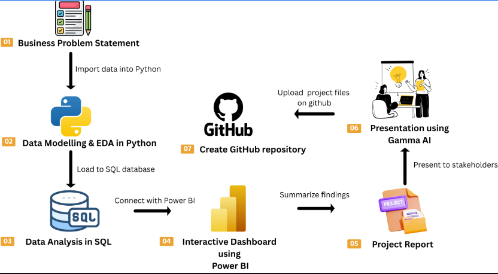
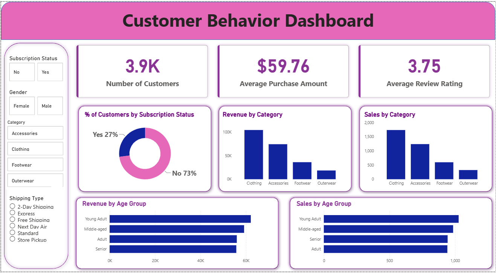

👩‍💻 Customer Shopping Behavior Analysis

An End-to-End Data Analytics Portfolio Project | Python · SQL · Power BI

Hi! I'm Astuti Singh, a BCA student interested in Data Analytics, Data Science, and turning raw data into meaningful insights.

This project is part of my learning journey to develop practical data analytics skills by working with customer shopping data. It covers the key stages of a typical analytics workflow, from data cleaning and exploratory analysis to SQL queries, dashboard creation, and business reporting.

🎯 About This Project

The goal of this project is to understand customer shopping behavior, explore purchasing patterns, and identify insights that can help businesses make data-driven decisions.

Through this project, I aim to practice:

- 🐍 Data Analysis with Python:** Loading, cleaning, transforming, and exploring data.
- 🗄️ SQL Analysis:** Querying data to answer business-related questions.
- 📊 Data Visualization with Power BI: Building an interactive dashboard to explore customer behavior.
- 📝 Reporting and Presentation: Summarizing findings and communicating insights clearly.
- 🚀 GitHub Portfolio Development: Organizing project files and documenting my work.

 🔄 Project Workflow

The project follows an end-to-end data analytics workflow:



1. Business Problem Statement — identify the questions to investigate.
2. Data Cleaning and EDA using Python — inspect, prepare, and explore the dataset.
3. Data Analysis using SQL — query the data to answer business questions.
4. Interactive Dashboard using Power BI — visualize metrics and customer trends.
5. Project Report — document findings and recommendations.
6. Presentation using Gamma AI — communicate the results in a clear presentation.
7. GitHub Repository — organize and share the project.

🛠️ Tools and Technologies

| Tool | Purpose |
|---|---|
| 🐍 Python | Data analysis and preprocessing |
| 🐼 Pandas | Data manipulation and cleaning |
| 🔢 NumPy | Numerical operations |
| 📊 Matplotlib and Seaborn | Data visualization |
| 📓 Jupyter Notebook | Writing and running Python analysis |
| 🗄️ SQL | Data querying and business analysis |
| 🐘 PostgreSQL | Database management |
| 📈 Power BI | Interactive dashboards |
| 🎨 Gamma AI | Presentation creation |
| 🔗 Git and GitHub | Version control and portfolio development |

📂 Dataset

The project uses customer shopping data to explore customer preferences and purchasing behavior.

Depending on the dataset, the analysis may include attributes such as:

- Customer ID
- Age and gender
- Product category
- Purchase amount
- Subscription status
- Shipping type
- Payment method
- Customer review rating

The final dataset description and column names should match the actual dataset used in the project.*

🐍 Python: Data Cleaning and Exploratory Data Analysis

Python and Pandas are used to explore the dataset and prepare it for analysis.

Key activities include:

- Inspecting the dataset structure and data types.
- Checking for missing values and duplicate records.
- Cleaning inconsistent values where necessary.
- Exploring numerical and categorical variables.
- Comparing shopping behavior across customer groups.
- Creating visualizations to identify patterns and trends.

🗄️ SQL: Business Analysis

SQL helps investigate customer behavior through data filtering, aggregation, grouping, and other queries.

Example business questions include:

- What is the average purchase amount?
- Which product categories have the highest purchase totals?
- How does purchasing behavior vary across age groups?
- How do subscribed and non-subscribed customers compare?
- Which shipping options are most frequently selected?
- What are the average customer review ratings?

The final analysis will depend on the available dataset columns and the SQL queries implemented.

📊 Power BI Dashboard

The dashboard presents key metrics and comparisons related to customer shopping behavior.



Dashboard Highlights

- 👥 Number of Customers
- 💰 Average Purchase Amount
- ⭐ Average Review Rating
- 🔄 Customer Distribution by Subscription Status
- 🛍️ Revenue and Sales by Product Category
- 📈 Revenue and Sales by Age Group
- 🎛️ Interactive filters for customer and shopping attributes

📈 Results and Business Insights

The analysis aims to uncover useful patterns in customer purchasing behavior.

The final findings may cover:

- Product categories with the highest purchase totals.
- Differences in purchasing behavior across age groups.
- Subscription patterns among customers.
- Popular shipping and payment options.
- Customer review trends.

Note: Actual findings and numerical results will be documented here after verifying the analysis outputs.

💡 Learning Outcomes

Through this project, I aim to strengthen my understanding of:

- Data cleaning and exploratory data analysis.
- Python libraries for data manipulation and visualization.
- SQL queries for solving business questions.
- Connecting data analysis with dashboard development.
- Presenting insights through reports and visualizations.
- Documenting projects professionally using GitHub.

🚀 How to Run the Project

 Prerequisites

- Python installed on your system.
- The project dataset.
- Jupyter Notebook.
- A supported SQL database, if reproducing the SQL analysis.
- Power BI Desktop to open the dashboard file.

1. Clone the Repository

Replace the placeholder with your actual GitHub repository URL.
git clone https://github.com/Astuti07/customer_behavior_analysis.git
cd customer-shopping-behavior-analysis

2. Install Python Libraries
pip install pandas numpy matplotlib seaborn jupyter sqlalchemy
Install the appropriate database driver if required.

3. Load the Dataset

Place the dataset in the data folder and update the file path in your notebook.

 4. Run the Python Notebook
jupyter notebook

Open the analysis notebook and execute the cells in order.

5. Perform SQL Analysis

Connect to your selected SQL database, load the prepared dataset, and run the queries in the sql folder.

6. Explore the Power BI Dashboard

Open the .pbix file in Power BI Desktop and configure the data source if necessary.

Update these instructions to match the files and setup available in your repository.*
 
📁 Project Structure

```text
customer-shopping-behavior-analysis/
│
├── data/
│   └── shopping_data.csv
│
├── notebooks/
│   └── customer_analysis.ipynb
│
├── sql/
│   └── analysis_queries.sql
│
├── dashboard/
│   └── customer_dashboard.pbix
│
├── reports/
│   └── project_report.pdf
│
├── presentation/
│   └── project_presentation.pdf
│
├── requirements.txt
└── README.md
```
👩‍🎓 About Me

Astuti Singh 
BCA Student | Aspiring Data Analyst

I'm currently building my skills in Python, SQL, data analysis, and Power BI through hands-on projects and continuous learning.

I'm interested in opportunities where I can apply analytical thinking, solve practical problems, and continue growing in the field of data analytics.

⭐ Final Note

This project is a step in my journey toward becoming a Data Analyst. It reflects my effort to apply classroom learning to a practical data analytics workflow and build a portfolio that demonstrates my technical skills and learning progress.

Thank you for visiting my project! If you find it useful, feel free to ⭐ the repository.

